# Alpaquitay AI

> **Astra-style AI harness for VS Code — SDLC gates, DORA metrics, debt tracking, diff-first writes, specialist routing, a Docs agent for Word, Markdown, EPUB and PDF, and now an on-device AI engine (WebGPU / Wasm).**

[](./LICENSE)
[](https://github.com/sergioide007/alpaquitay-ai/releases)
[](./CHANGELOG.md)
[](./package.json)
[](https://marketplace.visualstudio.com/items?itemName=alpaquitay-ai.alpaquitay-ai)
[](https://open-vsx.org/extension/alpaquitay-ai/alpaquitay-ai)
[](https://github.com/sergioide007/alpaquitay-ai/stargazers)
[](https://www.specsolid.com)


---

## Contents

[User manual](https://alpaquitay-ai.specsolid.com/manual/en/) · [What is it](#what-is-alpaquitay-ai) · [Quick start](#quick-start) · [Harness](#the-harness-in-one-picture) · [Work tab (SDD)](#core-sdd-workflow) · [Docs tab](#docs-tab--edit-word-markdown-epub-and-pdf-with-an-agent) · [Local engine](#local-ai-engine--webgpu--wasm-on-your-machine) · [Architecture](#architecture) · [Providers](#ai-providers) · [Skills](#skills) · [Memory](#hierarchical-memory) · [Domain agents](#domain-agent-architecture--the-architecture-to-win-a-vertical) · [Settings](#settings-reference) · [Contributing](#contributing) · [Contact](#author--contact) · [License](#license)

---

## What is Alpaquitay AI?

Alpaquitay AI turns VS Code into a complete **harness-driven development environment**. Built on principles from Robert C. Martin (Uncle Bob), Martin Fowler, and Sergio Perez Ruiz's *Código Sintético*, it's not just a chatbot — it's a reception, routing, and trust layer that:

1. **Perceives** your project — fingerprint, stack, sources (never assumes `src/`)
2. **Decides** the right lane — Flash (free), Build (SDD), Deep (specialist)
3. **Shows** a preview before any write — diff-first, bounded
4. **Guards** with policy, checkpoints, and debt tracking
5. **Verifies** with DORA metrics, DoD gates, and agent review
6. **Leaves evidence** in `.alpaquitay/` (decisions, economy, debt)

**100% open source · MIT license · Privacy-first** — your code and prompts go directly to your chosen AI provider. No Alpaquitay server ever receives them; the optional local engine only downloads signed model files and runs them on your machine.

**User manual:** [English](https://alpaquitay-ai.specsolid.com/manual/en/) · [Español](https://alpaquitay-ai.specsolid.com/manual/) — every feature, step-by-step use cases and short videos of the real extension.

**Website:** [specsolid.com](https://www.specsolid.com) · **Book:** [Código Sintético](https://codigosintetico.specsolid.com) (Spanish) · [*Synthetic Code*](https://info-codigo-sintetico.specsolid.com/en/) (English) · **Videos:** [YouTube @codigosinteticolibro](https://www.youtube.com/@codigosinteticolibro) (Spanish)

---

## Quick Start

1. Install **Alpaquitay AI** from the [VS Code Marketplace](https://marketplace.visualstudio.com/items?itemName=alpaquitay-ai.alpaquitay-ai) or [Open VSX](https://open-vsx.org/extension/alpaquitay-ai/alpaquitay-ai).
2. Press `Ctrl+Alt+A` to open the Hub, then add a provider in **Settings** — a local model ([Ollama](https://ollama.com) / LM Studio) keeps everything on your machine.
3. **Code:** open the **Work** tab, generate a `spec.md`, and drag a task to *In Progress*.
4. **Writing:** open the **Docs** tab, pick a `.docx`, `.md`, `.epub` or `.pdf`, and tell the agent what to do.

The detailed, step-by-step version is [below](#step-by-step-setup).

---

## The harness in one picture

Every request is perceived, routed to exactly one lane, previewed before any write, guarded, verified and logged.


<p align="center">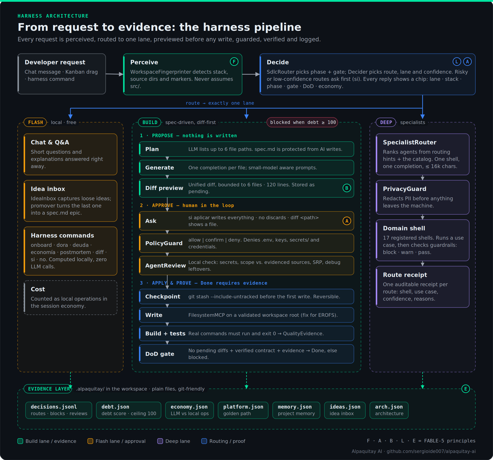</p>


## Harness Commands (free, no LLM)

| Command | Effect |
|---------|--------|
| `onboard` | Legacy onboarding: fingerprint + platform + ADR-001 + DORA |
| `dora` | DORA metrics from git log (frequency, lead time, change failure) |
| `deuda` | Agentic debt meter (ceiling at 100 blocks Build) |
| `economía` | Session cost: LLM calls vs free local operations |
| `postmortem <log>` | Classify a pasted failure (build/test/lint/write) |
| `diff <ruta>` | Show pending diff for a file |
| `si aplicar` | Review + checkpoint + write all pending diffs |
| `no` | Discard all pending diffs |
| `promover` | Promote last idea to spec.md epic |
| `si` | Confirm proposed route |

---

## FABLE-5 Framework

| Letter | Principle | Implementation |
|--------|-----------|----------------|
| **F** | **Fingerprint-first** | Detects stack from markers, never assumes `src/` |
| **A** | **Ask-before-act** | Every risky action asks for confirmation |
| **B** | **Bounded preview** | Unified diff capped at 6 files, 120 lines |
| **L** | **Legible-first** | Every response shows: lane · stack · phase · gate · DoD · economy |
| **E** | **Evidence-always** | Every decision in `.alpaquitay/decisions.jsonl` |

---

### SDLC gates

The harness detects the SDLC phase from the request and only lets it advance when the exit gate passes.


<p align="center">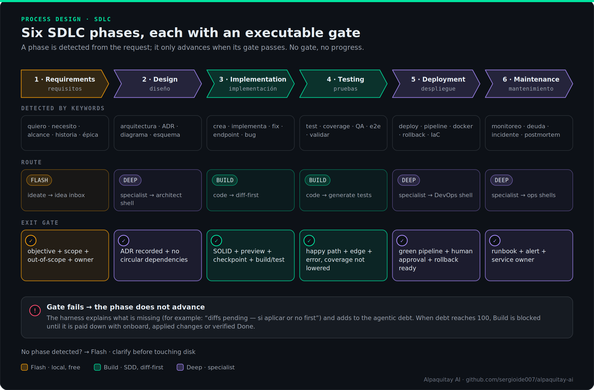</p>


---

## Core SDD Workflow

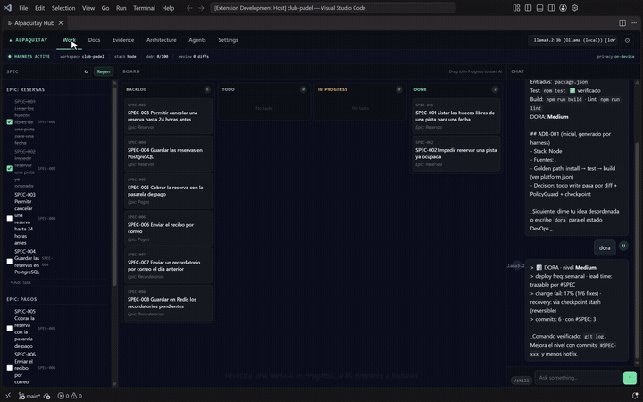

```
  spec.md ──► Kanban Board ──► AI implements task ──► spec.md [x] ──► git #SPEC-XXX
     ▲                                                        │
     └────────────────────────────────────────────────────────┘
                          feedback loop
```

1. Write (or AI-generate) a `spec.md` with epics and tasks
2. Drag a task card to **In Progress** on the board
3. The AI scans the workspace, plans which files to create, and writes the code
4. The task auto-moves to **Done** and `spec.md` is updated (`- [x]`)
5. Git commits reference `#SPEC-001` — every change is traceable to a requirement

---

### How a task runs

Dragging a card to **In Progress** never writes silently. The agent plans up to 6 files, generates them, and stores the result as a **bounded diff**. Nothing touches disk until you answer `si aplicar` (or `no` to discard). On apply, PolicyGuard and AgentReview check each file, a git checkpoint is taken, files are written, and **real build and test commands** run. A card only reaches **Done** when the Definition-of-Done gate has evidence.


<p align="center">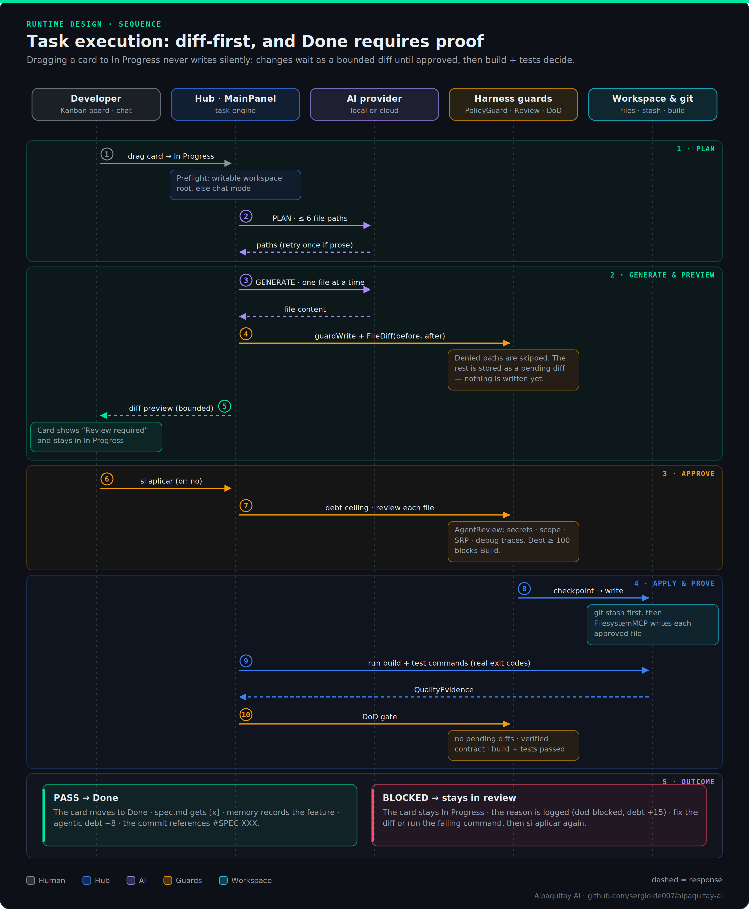</p>


### Step-by-step setup

#### Step 1 — Install

**Option A — VS Code Marketplace (recommended):**

Search **"Alpaquitay AI"** in the Extensions panel, or run:

```bash
code --install-extension alpaquitay-ai.alpaquitay-ai
```

**Option B — Open VSX (VS Codium / other editors):**

Install from [open-vsx.org/extension/alpaquitay-ai/alpaquitay-ai](https://open-vsx.org/extension/alpaquitay-ai/alpaquitay-ai), or run:

```bash
ovsx install alpaquitay-ai.alpaquitay-ai
```

#### Step 2 — Configure a provider

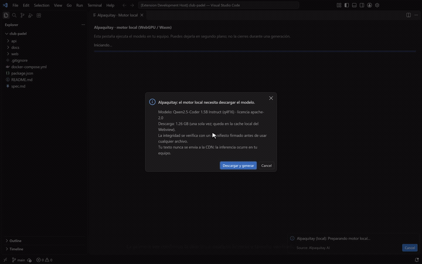

**Local (free, fully private):**

```bash
# Ollama — auto-detected at http://localhost:11434
ollama pull codellama
# Other options: llama3, mistral, qwen2.5-coder, deepseek-coder

# LM Studio — auto-detected at http://localhost:1234
# Load any GGUF model inside LM Studio, then start the local server
```

**Cloud (Anthropic / OpenAI):**

Open the command menu with `Ctrl+Shift+A` → select **Configure AI Provider** → enter your API key.
Keys are stored in the OS keychain via VS Code SecretStorage — never in plaintext, never in settings files.

> **Small model note:** Models under ~4B parameters (`1.3b`, `3b`, `mini`, `nano`, `gemma:2b`, etc.) are detected automatically. Stricter no-comment rules are injected and generation temperature is lowered so they produce cleaner output.

#### Step 3 — Open the hub

```
Ctrl+Shift+A   →  Command menu (choose hub or other commands)
Ctrl+Alt+A     →  Open Alpaquitay Hub directly
```

#### Step 4 — Create your spec

In the **Work** tab → **Spec** pane → click **+ Create with AI** (or **Regen**, with an optional project description). The AI analyzes your workspace and creates an initial `spec.md` with epics and tasks. Refine it by hand. Prefer the board for new tasks: a code request confirmed in the chat regenerates `spec.md` from that request (a Git checkpoint is saved first).

#### Step 5 — Work tasks

On the **Board** pane, all tasks start in **Backlog**. Drag one to **In Progress** — the AI immediately starts implementing it and streams progress to the **Chat** pane.

---

## spec.md Format

Standard Markdown with checkboxes. Level-2 headings define epics; checkboxes define tasks.

```markdown
# My Project

Brief description.

## Epic: Authentication

- [ ] SPEC-001 Implement JWT provider
- [ ] SPEC-002 Add refresh token rotation
- [x] SPEC-003 Design auth flow

## Epic: Dashboard

- [ ] SPEC-004 Build metrics chart component
- [ ] SPEC-005 Add CSV export
```

**Rules:**
- `## Heading` → epic group
- `- [ ] text` → pending task
- `- [x] text` → completed task
- Task IDs (`SPEC-001`, `SPEC-002`, ...) are auto-assigned by position
- Free-form text between tasks is used as AI context

---

## Git Convention

Reference a spec task in your commit message to link it in the Git tab:

```
feat(auth): implement JWT provider #SPEC-001

Handles token generation, expiry, and validation. Uses RS256.
```

Both `#SPEC-001` and `[SPEC: 001]` formats are recognized. The Git tab shows a badge on that commit.

---

---

## Docs tab — edit Word, Markdown, EPUB and PDF with an agent

A main tab, next to **Work**, for everything that is not code: manuscripts, reports, articles, and the books you write and edit. You talk to the agent in plain language, in Spanish or English:

> *"corrige la ortografía del capítulo 3"* · *"hazlo más directo, mantén mi voz"* · *"translate the book to English"* · *"revisa la coherencia entre capítulos"* · *"¿qué le falta a este capítulo?"*

| Format | Read | Write | Notes |
|---|---|---|---|
| `.docx` | ✅ | ✅ | Edits are written as **Word tracked changes** (Review → Accept / Reject). Untouched paragraphs stay byte-identical. |
| `.md` / `.txt` | ✅ | ✅ | Lossless outside the edited blocks; code blocks, tables and front matter are protected. |
| `.epub` | ✅ | ✅ | Chapters follow the spine; `<em>` / `<strong>` survive a round trip. |
| `.pdf` | ✅ | ➡️ `.md` | Read-only, best effort (text-based PDFs). Scanned PDFs need OCR first. |

Convert any document to **Markdown, Word or EPUB** from the same tab, so a manuscript in Markdown becomes a publishable EPUB in one click.

**What the agent can do**

- **Edit:** proofread · improve style · shorten · expand · translate · any free-form instruction.
- **Analyze:** summarize · outline · **cross-chapter consistency check** (names, dates, places, terminology) · developmental feedback · questions about the book.

**Same guarantees as the code side**

- The agent only **proposes**. You review a **word-level diff** per paragraph and select what to apply. Large rewrites, changed numbers and big length changes are flagged *review* and are **not pre-selected**.
- Output goes to a **new file** by default (`name.edited.docx`). Overwriting makes a backup first in `.alpaquitay/backups/`.
- Links, footnotes, fields, images, tables and code are **protected blocks** the agent never touches.
- The written file is **re-read to verify** it parses and contains every accepted edit.
- Whole-book runs over 20 model calls ask for confirmation (hard limit 60). Cloud providers go through the privacy boundary (PII and secrets redacted); a local model keeps the manuscript on your machine.
- No dependencies: the ZIP, DOCX, EPUB and PDF readers/writers are built in, so the extension stays small and auditable.


<p align="center">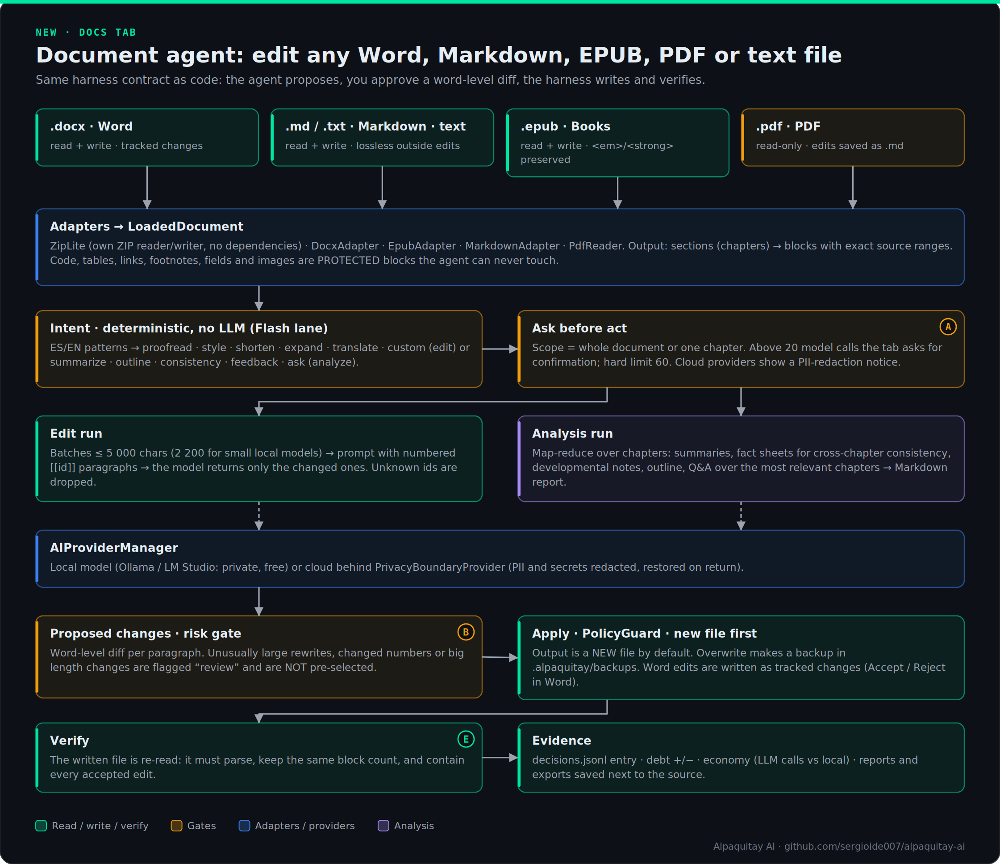</p>


**Limits, stated plainly:** in a Word paragraph that the agent rewrites, inline formatting inside that paragraph (a bold word, for example) is replaced by the run formatting of its first run. The tracked-changes view shows exactly what changed. Paragraphs with hyperlinks, fields or notes are skipped instead of risking damage.

---

## Local AI engine — WebGPU / Wasm on your machine

Run a small ONNX language model (default: Qwen2.5-Coder 1.5B Instruct) **inside VS Code, on your own GPU**. Nothing is sent to a model server: the weights are static files from the project CDN (`alpaquitay.specsolid.com`), downloaded once and kept in IndexedDB. Inference cost on the backend side: **$0**.

<p align="center">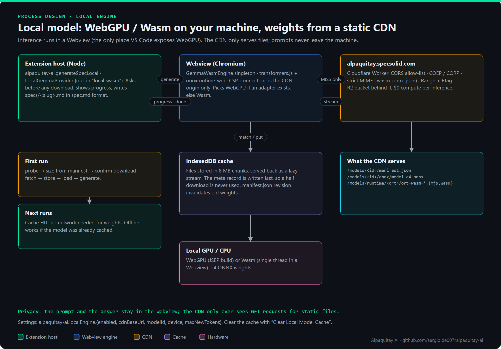</p>

**Try it:** run **`Alpaquitay AI: Generate Specification (Local Model)`** from the Command Palette (or the `Ctrl+Shift+A` menu). Select some text first, or describe the feature in the prompt box. The first run shows the **verified download size** and license and asks for confirmation; after that it works offline. The result is written to `specs/<name>.md` in the same `spec.md` format the Work tab reads (existing specs are never overwritten).

**The download needs your click.** On the first run (and whenever the model revision changes) VS Code shows a modal dialog, *"Alpaquitay: el motor local necesita descargar el modelo."*, with the model, its license, the download size and the privacy note. Nothing is downloaded until you press **Descargar y generar**; **Cancel** (or `Esc`) stops the command and nothing leaves your machine. With VS Code's default `window.dialogStyle` (`native`) this is an **operating-system dialog**, a separate window that may not sit where you are looking; meanwhile the progress notification waits on *Preparando motor local…* until you answer it. Set `"window.dialogStyle": "custom"` if you prefer the dialog drawn inside the VS Code window.

**Be realistic about it:**

- The default model is **Qwen2.5-Coder 1.5B Instruct** (`q4f16`, **≈1.26 GB** to download, Apache-2.0), chosen by measurement in a real VS Code: it was the only code-specialised candidate that loaded in the WebGPU runtime, and it wrote the best specifications (≈4 tok/s on an Intel UHD integrated GPU). It needs **WebGPU with `shader-f16`**: if the machine has neither, the extension refuses *before* downloading and says why. Comparison and method: [`docs/LOCAL-ENGINE.md` §6](./docs/LOCAL-ENGINE.md#6-choosing-the-model-measured-2026-11-15).
- Output is a **first draft**. A 1.5B model will not match a cloud model; if it ignores the spec format the command warns you.
- It is **opt-in** and has not yet been exercised in every VS Code/GPU combination: see the checklist in [`docs/LOCAL-ENGINE.md`](./docs/LOCAL-ENGINE.md#8-what-is-not-verified-yet).

**Security model, in one paragraph:** the CDN is treated as untrusted. Each model manifest is **signed with Ed25519** and lists a **SHA-256 for every 8 MiB block** of every file; the Webview refuses any byte that does not match, any file that is not listed, and any older signed manifest (anti-rollback). The ONNX Runtime files are **pinned by hash inside the extension**, and the Webview's CSP allows no remote script origin. The manifest is fetched **without any decompression**, so no decoder parses network bytes before the signature check. CDN address, model and trusted keys can only be set in *user* settings, never by a workspace. Threat model, failure register and the answers to the objections architects raise: [`docs/LOCAL-ENGINE.md`](./docs/LOCAL-ENGINE.md).

**Use it as a provider:** set `alpaquitay-ai.localEngine.enabled: true`. The engine then appears as a local provider (`local-wasm`): `auto` tries Ollama and LM Studio first and falls back to it, and you can pick it with `alpaquitay-ai.preferredProvider: "local-wasm"`.

**Set it up with a real model** (selective download, graph preparation, staging, signing, deploying the Worker and verifying the live CDN): [`docs/LOCAL-ENGINE.md` §6–7](./docs/LOCAL-ENGINE.md#6-choosing-the-model-measured-2026-11-15) and [`worker/README.md`](./worker/README.md). The signing key is generated on your machine (`npm run cdn:keygen`); the repository ships with none.

**How it works**

- **Webview, not the extension host.** The Node extension host has no WebGPU. The engine (`GemmaWasmEngine`, bundled to `dist/engine-webview.js`) runs in a Webview tab that can stay in the background.
- **Device and precision.** `device: auto` uses WebGPU when a real adapter exists. `dtype: auto` uses `q4f16` only with WebGPU **and** `shader-f16`, otherwise `q4` (some Gemma exports produce garbage in fp16).
- **IndexedDB cache.** Files are stored in 8 MiB chunks and a half-finished download is never served. When the manifest `revision` changes, old weights are dropped. transformers.js still reads each file fully into memory to build the ONNX session, so peak memory is roughly the model size. `Clear Local Model Cache` empties it.
- **One inference at a time**, cancellable per request.
- **The CDN is a Cloudflare Worker** (`worker/`) in front of an R2 bucket: CORS allow-list, `Cross-Origin-Embedder-Policy` / `Cross-Origin-Resource-Policy`, strict MIME types (anything else returns 415), `Range` and `ETag`, `no-transform`, immutable caching for weights and revalidation for the manifest. `npm run cdn:verify` checks the live CDN end to end.

---

## Architecture

### Extension host


<p align="center">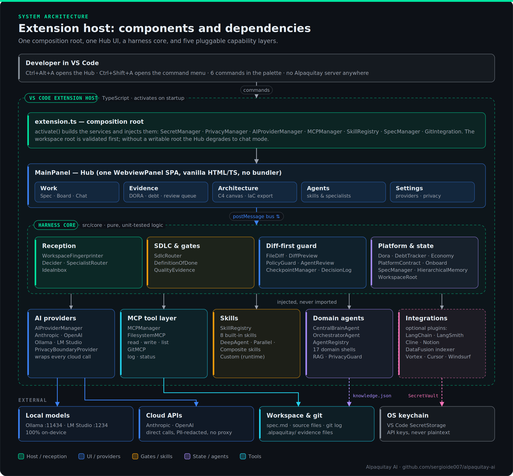</p>


### AI provider chain and privacy boundary

Local models run untouched. Anything that leaves the machine is redacted first and audited without values. The reply comes back as the provider wrote it: placeholders are not reversed.


<p align="center">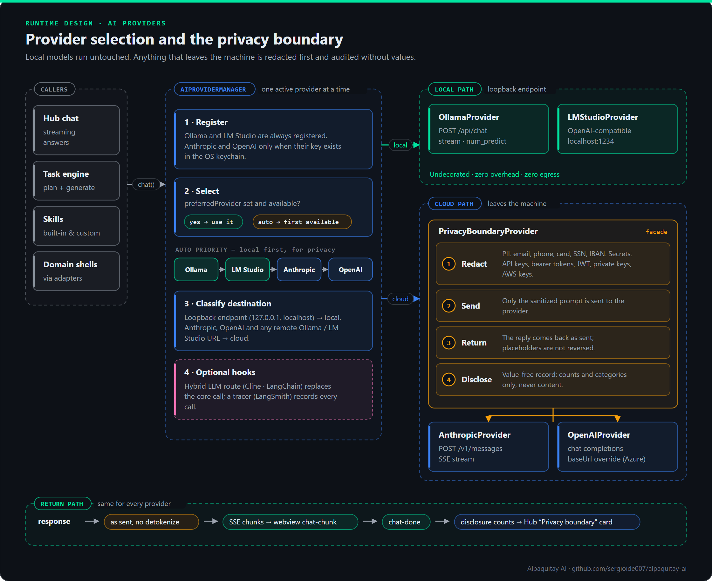</p>


### Architecture diagram module (Arch tab)

The canvas infers the real system from manifests, Docker Compose and `spec.md`, then exports starter infrastructure code.


<p align="center">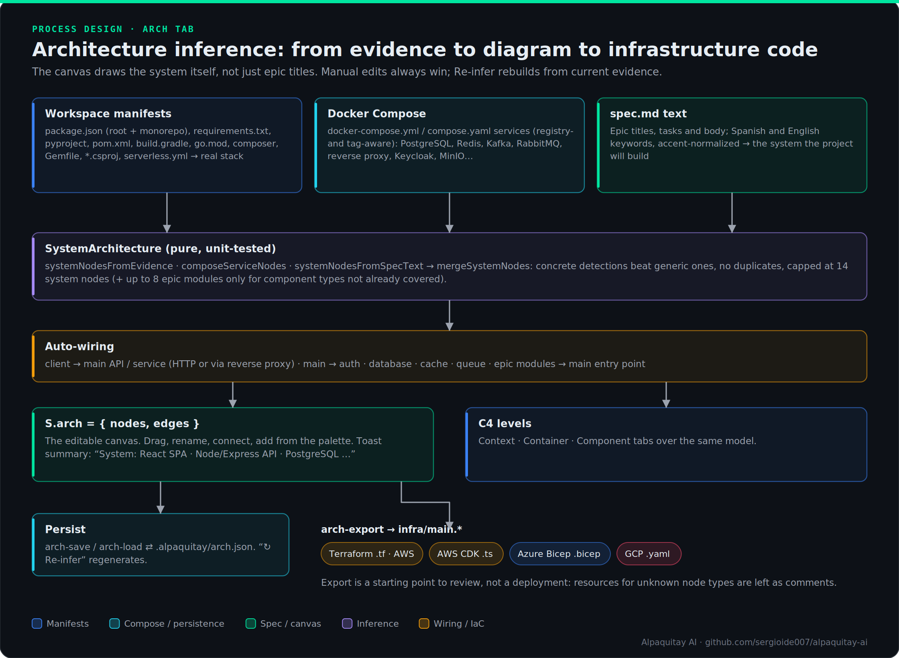</p>


### Clean Architecture project generation


<p align="center">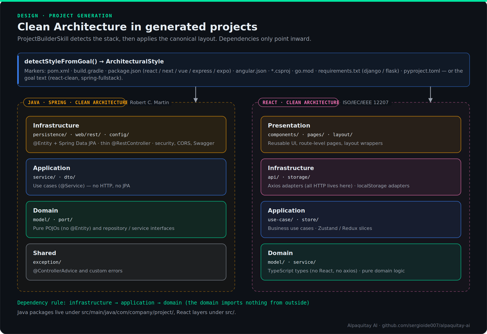</p>


---

## AI Providers

| Provider | Type | Privacy | Cost | Setup |
|---|---|---|---|---|
| Ollama | Local | 100% on-device | Free | `ollama pull <model>` |
| LM Studio | Local | 100% on-device | Free | Load model, start server |
| Local model (WebGPU / Wasm) | Local | 100% on-device (one-time model download from the CDN) | Free | `alpaquitay-ai.localEngine.enabled: true` |
| Anthropic Claude | Cloud | Direct API | API pricing | API key in keychain |
| OpenAI GPT | Cloud | Direct API | API pricing | API key in keychain |

### Anthropic Models

Checked against Anthropic's model documentation on 2026-11-15. Prices are per million input / output tokens.

| Model | ID | Context | Max output | Price | Best for |
|---|---|---|---|---|---|
| Claude Opus 5.5 | `claude-opus-5-5` | 1M | 128k | $4 / $20 | **Default.** Complex architecture, multi-file tasks, reviews |
| Claude Sonnet 5.5 | `claude-sonnet-5-5` | 1M | 128k | $2 / $10 | Everyday coding at half the price of Opus |
| Claude Haiku 5.5 | `claude-haiku-5-5` | 1M | 128k | $0.10 / $0.50 | Fast, high-volume, simple tasks |
| Claude Fable 5.2 | `claude-fable-5-2` | 1M | 128k | $8 / $40 | The most demanding reasoning (needs 30-day data retention on your account) |

### OpenAI Models

Checked against developers.openai.com on 2026-11-15. All four are reasoning models.

| Model | ID | Context | Max output | Price | Best for |
|---|---|---|---|---|---|
| GPT-6.1 Sol | `gpt-6.1-sol` | 1.05M | 128k | $2 / $10 | **Default.** OpenAI's balance of intelligence and cost |
| GPT-6 Astra | `gpt-6-astra` | 1.05M | 128k | $10 / $50 | OpenAI's most capable model |
| GPT-6.1 Terra | `gpt-6.1-terra` | 1.05M | 128k | $1 / $5 | Fast and efficient; writing and revising text |
| GPT-6 Luna | `gpt-6-luna` | 1.05M | 128k | $0.10 / $0.50 | Cost-sensitive, high-volume work |

Any other model ID your account can use works too: type it in `alpaquitay-ai.anthropic.model` or `alpaquitay-ai.openai.model`. Alpaquitay sends sampling parameters (`temperature`) only to models that accept them, and leaves room for reasoning tokens on models that think before answering.

---

## Skills

### Built-in Skills

| ID | Name | Description |
|---|---|---|
| `create-file` | Create File | Generates a new source file from a description |
| `refactor` | Refactor Code | Applies SOLID principles and clean code patterns |
| `generate-tests` | Generate Tests | Writes unit tests for the active file |
| `generate-from-spec` | Generate from Spec | DeepAgent: reads spec, plans files, generates all |
| `validate-against-spec` | Validate vs Spec | Checks implementation matches the spec |
| `new-specification` | New Specification | Creates a new spec.md from a template |
| `project-builder` | Project Builder | Scaffolds a full project from a goal description |
| `daily-standup` | Daily Standup | Standup summary from recent git commits |

### Custom Skills (TypeScript)

```typescript
import { Skill, SkillContext, SkillResult } from './core/interfaces';

export class DocumentationSkill implements Skill {
  readonly id = 'generate-docs';
  readonly name = 'Generate Docs';
  readonly description = 'Write JSDoc for all exported functions';

  async execute(ctx: SkillContext): Promise<SkillResult> {
    const { path } = ctx.parameters as { path: string };
    const file = await ctx.mcp.executeTool('filesystem', 'read_file', { path }) as { content: string };
    const documented = await ctx.ai.complete(
      `Add complete JSDoc to all exported functions.\n\n${file.content}\n\nReturn only the updated file.`
    );
    await ctx.mcp.executeTool('filesystem', 'write_file', { path, content: documented });
    return { success: true, output: { path } };
  }
}
```

### DeepAgent Multi-Step Skills

```typescript
// Each step's output is available to all subsequent steps
const steps: AgentStep[] = [
  { name: 'detect-context', async run(ctx)           { return detectStack(ctx); } },
  { name: 'plan-files',     async run(ctx, outputs)  { return planFiles(ctx, outputs['detect-context']); } },
  { name: 'generate-files', async run(ctx, outputs)  { return generateFiles(ctx, outputs['plan-files']); } },
];
export const MySkill = new DeepAgentSkill('my-skill', 'My Skill', 'Description', steps);
```

---
## Hierarchical Memory

Alpaquitay maintains a **hierarchical project memory** in `.alpaquitay/memory.json`. As the AI generates code, it automatically records:

| Level | What is stored |
|---|---|
| `project` | Name, description, architecture decisions |
| `component` | Major subsystems (auth, dashboard, API layer) |
| `module` | Specific modules within a component |
| `feature` | Completed spec tasks with their output files |
| `class` | Class names and which file they live in |
| `method` | Top-level exported functions |
| `package` | External packages and why they were chosen |
| `config` | Configuration entries |

This memory persists across sessions. Future tasks can query it to maintain consistency — e.g., knowing that `UserService` is in `src/services/user.ts` before generating a file that imports it.

---
## Supported Project Architectures

Alpaquitay auto-detects the stack from project files and generates architecture-specific prompts and directory structures.

| Style | Detection | Structure | Architecture Pattern |
|---|---|---|---|
| `react-spa` | `package.json` (react) | src/components, pages | Functional + Hooks |
| `react-clean` | goal text | domain/application/infrastructure/presentation | Clean Architecture |
| `react-node` | `package.json` (react+express) | client/ + server/ | MVC full-stack |
| `nextjs` | `package.json` (next) | app/ (App Router) | Server + Client components |
| `vue-spa` | `package.json` (vue) | src/components, views | Composition API + Pinia |
| `angular` | `angular.json` | src/app/ | Standalone components + NgRx |
| `express-api` | `package.json` (express) | routes/controllers/services | REST MVC |
| `java-maven` | `pom.xml` | domain/application/infrastructure/shared | **Clean Architecture** |
| `java-gradle` | `build.gradle` | domain/application/infrastructure/shared | **Clean Architecture** |
| `spring-fullstack` | goal text | backend/ + frontend/ (monorepo) | CA backend + CA frontend |
| `csharp-webapi` | `*.csproj` | Controllers/Services/Models | Minimal API / MVC |
| `go-api` | `go.mod` | cmd/internal/pkg | Effective Go |
| `django` | `requirements.txt` | apps/ pattern | DRF ViewSets + ModelSerializer |
| `flask` | `requirements.txt` | blueprints/ | Application factory |
| `python-package` | `pyproject.toml` | package/__init__.py | PEP 517 |
| `react-native` | `package.json` (expo) | src/screens/components | React Navigation |

All Java projects follow **Clean Architecture** (Robert C. Martin) with strict dependency inversion: `infrastructure → application → domain`.

---
## Commands & Shortcuts

| Command | Shortcut | Description |
|---|---|---|
| `Alpaquitay AI: Open Hub` | `Ctrl+Alt+A` | Open the unified panel |
| `Alpaquitay AI: Show Menu` | `Ctrl+Shift+A` | Quick menu with all commands |
| `Alpaquitay AI: New Specification` | — | Create a spec from a template |
| `Alpaquitay AI: Generate from Spec` | — | AI generates code from a selected spec (writes the files directly, without a diff: use a clean Git tree) |
| `Alpaquitay AI: Validate Against Spec` | — | Check implementation vs spec |
| `Alpaquitay AI: Configure AI Provider` | — | Set API key or local endpoint |
| `Alpaquitay AI: Generate Specification (Local Model)` | — | Write a spec with the on-device model |
| `Alpaquitay AI: Clear Local Model Cache` | — | Delete the model files cached in IndexedDB |

> `Ctrl+Shift+A` shows a popup menu so it does not conflict with GitHub Copilot's agent menu, which uses the same shortcut when Alpaquitay is not installed.

---

## Settings Reference

All settings are configurable in VS Code's settings UI or `settings.json`. Provider-specific settings can also be changed from the **Settings** tab inside the hub.

| Setting | Default | Description |
|---|---|---|
| `alpaquitay-ai.preferredProvider` | `auto` | `auto` tries local first, then cloud |
| `alpaquitay-ai.anthropic.model` | `claude-opus-5-5` | Anthropic model ID |
| `alpaquitay-ai.anthropic.baseUrl` | Anthropic API | Override for proxies or compatible APIs |
| `alpaquitay-ai.openai.model` | `gpt-6.1-sol` | OpenAI model ID |
| `alpaquitay-ai.openai.baseUrl` | OpenAI API | Override for Azure OpenAI |
| `alpaquitay-ai.ollama.endpoint` | `http://localhost:11434` | Ollama server address |
| `alpaquitay-ai.ollama.model` | `codellama` | Ollama model name |
| `alpaquitay-ai.lmstudio.endpoint` | `http://localhost:1234` | LM Studio server address |
| `alpaquitay-ai.localEngine.enabled` | `false` | Allow the local engine as an AI provider (the spec command works either way) |
| `alpaquitay-ai.localEngine.cdnBaseUrl` | `https://alpaquitay.specsolid.com` | Origin that serves `/models/` (https; user settings only) |
| `alpaquitay-ai.localEngine.modelId` | `qwen2.5-coder-1.5b-instruct` | Folder under `/models/` with `manifest.json` + `manifest.sig.json` (user settings only) |
| `alpaquitay-ai.localEngine.dtype` | `auto` | Weight precision: `auto`, `q4`, `q4f16`, `q8`, `fp16`, `fp32` |
| `alpaquitay-ai.localEngine.extraTrustedKeys` | `[]` | Extra Ed25519 public keys for a self-hosted mirror (user settings only) |
| `alpaquitay-ai.localEngine.device` | `auto` | `auto`, `webgpu` or `wasm` |
| `alpaquitay-ai.localEngine.maxNewTokens` | `1024` | Max new tokens per local generation |
| `alpaquitay-ai.maxTokens` | `4096` | Default max tokens per request |
| `alpaquitay-ai.temperature` | `0.3` | 0 = deterministic, 2 = creative |
| `alpaquitay-ai.requestTimeout` | `120000` | Request timeout in ms |
| `alpaquitay-ai.specFile` | `spec.md` | Spec filename in workspace root |
| `alpaquitay-ai.skill.maxParallel` | `3` | Max concurrent parallel skills |
| `alpaquitay-ai.mcp.filesystem.enabled` | `true` | Enable filesystem read/write tool |
| `alpaquitay-ai.mcp.git.enabled` | `true` | Enable git log tool |

---

## Key Design Decisions

**spec.md as the database.** Board state is derived from the spec file, never stored separately. Git diffs are human-readable; there is no sync problem between board and file.

**MCP as the tool layer.** The AI does not call VS Code APIs directly. It invokes tools (`filesystem.read_file`, `filesystem.write_file`) through a typed MCP executor, making skills unit-testable outside VS Code.

**Small model awareness.** Models under ~4B parameters are detected by name pattern. They receive stripped-down system prompts (no epic context, no masterPrompt), zero-comment rules, and post-processing strips any narration comments they emit despite the instructions.

**Hierarchical memory.** After each code generation, class names, exported functions, and completed feature records are extracted and stored. This builds a growing project index that keeps multi-session AI context coherent.

**Single WebviewPanel SPA.** Everything in one editor tab. The webview is vanilla TypeScript-compiled HTML — no React, no bundler, fast startup, no dependency on frontend tooling in the workspace.

**Fire-and-forget task engine.** `_startTaskWork()` runs asynchronously and streams progress to the webview via `chat-chunk` events. If the AI call fails, the error appears in Chat and the card reverts — no silent failures.

**spec.md protection.** During task work, if the AI tries to write to `spec.md` (its source of truth), the write is silently skipped. This prevents the AI from accidentally erasing all task checkboxes.

---

## Domain Agent Architecture — The Architecture to Win a Vertical

> *Stop building better prompts. Build autonomous agents that own entire workflows end-to-end.*

Every industry will have an AI agent winner. The winner won't be the one with the best LLM — it will be the one who knows the **domain's edge cases better than anyone else**. The LLM is commodity. The moat is in the domain layer: the tool integrations, the compliance rules, the institutional knowledge encoded as structured prompts and validation guardrails.

Alpaquitay's agent engine already embodies the loop:

```
Objective → Decompose → Domain Tools → Validate → Done
```

A **Domain Agent Shell** wraps this engine in a vertical-specific layer and connects it to the real APIs, databases, and compliance rules of a particular industry.

### The Architecture to Win a Vertical

<details>
<summary>Text version of this diagram</summary>

```
┌──────────────────────────────────────────────────────┐
│                 DOMAIN AGENT SHELL                   │
│                                                      │
│  ┌───────────────────┐  ┌────────────────────────┐   │
│  │ Process           │  │ Domain Tools           │   │
│  │ Definition        │  │ (Real APIs / ERPs)     │   │
│  │ (replaces spec.md)│  │                        │   │
│  └───────────────────┘  └────────────────────────┘   │
│                                                      │
│  ┌───────────────────────────────────────────────┐   │
│  │          ALPAQUITAY AGENT ENGINE              │   │
│  │    decompose  →  execute  →  validate         │   │
│  └───────────────────────────────────────────────┘   │
│                                                      │
│  ┌───────────────────┐  ┌────────────────────────┐   │
│  │ Domain Memory     │  │ Compliance Guardrails  │   │
│  │ (persistent ctx)  │  │ (domain-specific rules)│   │
│  └───────────────────┘  └────────────────────────┘   │
└──────────────────────────────────────────────────────┘
```

</details>

| Layer | Alpaquitay Dev Tool | Domain Agent Shell |
|---|---|---|
| Objective | `spec.md` | Process Definition (SOP / BPMN) |
| Decomposition | Kanban tasks | Domain workflow steps |
| Tools | filesystem, git MCP | Industry APIs (ERP, CRM, TMS, legal DB) |
| Validation | build + diagnostics | Business rules + compliance guardrails |
| Memory | `HierarchicalMemory` | Domain-scoped learner/case/patient context |

---

### Architectural Foundations

#### ISO Industry Standards

Each vertical domain is anchored to its governing ISO standard so the agent's process definition is traceable to real-world compliance requirements:

| Domain | Primary ISO / Standard | Key Compliance Concern |
|---|---|---|
| **English Learning** ✅ | CEFR · ISO 17024 · ISO 21001 | Competency assessment validity |
| **Software Engineer** ✅ | ISO/IEC 25010 · 12207 · SOLID | Code quality, maintainability |
| **Software Architect** ✅ | ISO/IEC 42010 · TOGAF · C4 | Architecture decision traceability |
| **Developer** ✅ | ISO/IEC 12207 · Clean Code | Implementation quality |
| **QA** ✅ | ISO/IEC 29119 · IEEE 829 | Test coverage, defect severity |
| **DevOps** ✅ | DORA Metrics · ISO/IEC 27001 | Deployment frequency, MTTR |
| **DevSecOps** ✅ | OWASP SAMM · ISO/IEC 27001 | Shift-left security maturity |
| **Security** ✅ | NIST CSF · ISO/IEC 27001/27005 | Risk classification, incident response |
| **Infrastructure** ✅ | ISO/IEC 27001 · ITIL v4 | Availability, capacity planning |
| **Cloud (AWS/Azure/GCP)** ✅ | AWS WAF · ISO/IEC 27017 | Well-architected, cost optimisation |
| **Marketing** ✅ | ISO 9001 · IAB Standards | Campaign attribution, ROI |
| **Process** ✅ | ISO 9001 · BPM CBOK · Six Sigma | Process efficiency, compliance |
| **AI Expert** ✅ | ISO/IEC 42001 · EU AI Act · NIST AI RMF | AI governance, risk classification |
| **Business** ✅ | ISO 56002 · OKR · BMC | Business model viability, runway |
| Finance | ISO 20022 · BIAN Banking Standards | Transaction integrity, audit trail |
| Legal | ISO/IEC 27001 · GDPR (Regulation) | Data sovereignty, chain of custody |
| Logistics | ISO 9001 · GS1 Standards | Traceability, SLA adherence |
| Recruiting | ISO 30405 (Human resource management) | Bias-free assessment, GDPR |
| Healthcare | ISO 13485 · HL7 FHIR | Patient safety, data accuracy |

#### TOGAF ADM Alignment

Each Domain Agent Shell is architected through TOGAF's Architecture Development Method phases:

```
Phase B — Business Architecture    : Domain process model (BPMN / ArchiMate Motivation)
Phase C — Application Architecture : Use cases, ports, adapters (Hexagonal)
Phase D — Technology Architecture  : AI provider, storage, external APIs
Phase E — Opportunities & Solutions: Compliance guardrails, risk mitigation
Phase F — Migration Planning       : Version-controlled domain memory
```

#### ArchiMate 3.2 Notation

<details>
<summary>Text version of this diagram</summary>

```
Business Layer   : Business Process ──► Business Service (domain workflow)
Application Layer: Application Service ──► Application Component (use cases)
                   Application Interface (primary ports exposed to callers)
                   Application Interface (secondary ports to infrastructure)
Technology Layer : Technology Service (AI Provider, Storage, APIs)
```

</details>

#### BIAN Service Domain Pattern

Each Domain Agent Shell maps to a BIAN Service Domain:
- **English**: Learning Progress · Competency Assessment · Content Generation
- **Software Engineer**: Code Quality Assessment · Technical Debt Management · Pattern Advisory
- **Software Architect**: Architecture Decision Record · Quality Attribute Evaluation · Tech Radar
- **Developer**: Feature Implementation · Debug Assistance · Code Explanation
- **QA**: Test Planning · Defect Triage · Quality Gate Definition
- **DevOps**: CI/CD Pipeline Design · DORA Assessment · Infrastructure-as-Code Generation
- **DevSecOps**: Secure Pipeline Design · Threat Modelling · SBOM Generation · SAMM Assessment
- **Security**: Compliance Audit · Penetration Test Planning · Risk Register · Incident Response
- **Infrastructure**: Capacity Planning · Network Design · DR Planning · SLA Definition
- **Cloud**: Well-Architected Review · Cost Optimisation · Cloud Migration Planning
- **Marketing**: Campaign Planning · Audience Segmentation · SEO Analysis · ROI Measurement
- **Process**: Process Mapping · Gap Analysis · Value Stream Mapping · ISO Compliance
- **AI Expert**: LLM Evaluation · RAG Architecture · Prompt Engineering · AI Governance
- **Business**: Business Model Canvas · OKR Definition · Financial Model · Market Analysis
- **Finance**: Payment Order · Credit Assessment · Regulatory Reporting
- **Legal**: Contract Review · Compliance Monitoring · Document Classification
- **Logistics**: Shipment Tracking · Route Optimization · Carrier Management

---

### 4+1 Architectural Views

#### 1. Logical View — Domain Model
Pure domain objects with zero framework imports. Entities, value objects, and aggregate roots define the business language of the vertical.

#### 2. Development View — Hexagonal Package Structure
```
src/domains/
  interfaces/           ← DomainAgentShell (base contract for all shells)
  {vertical}/
    domain/             ← Pure model (entities, value objects)
    ports/
      input.ts          ← Primary ports (driving) — what callers invoke
      output.ts         ← Secondary ports (driven) — what infra implements
    application/        ← Use cases (orchestrate domain + ports)
    infrastructure/     ← Adapters (AI provider, storage, external APIs)
    {Vertical}DomainShell.ts  ← Main orchestrator implements IDomainAgentShell
```

#### 3. Process View — Agent Execution Loop
<details>
<summary>Text version of this diagram</summary>

```
Receive Objective
      │
      ▼
  Decompose into Use Cases  (Process Definition)
      │
      ├── UseCase 1 ──► Primary Port ──► Application Service
      │                                        │
      │                              Secondary Port ──► Adapter ──► Real API
      │
      ├── Compliance Guardrail check
      │
      ├── Persist to Domain Memory
      │
      └── Return DomainResult
```

</details>

#### 4. Physical View — Deployment
<details>
<summary>Text version of this diagram</summary>

```
VS Code Extension Host
  ├── CentralBrainAgent          ← Unified entry point (RAG + Privacy + Orchestration)
  │     ├── RAGEngine            ──► .alpaquitay/orchestration/knowledge.json (BM25-lite)
  │     ├── PrivacyGuard         ──► PII detection/masking (GDPR / ISO 27018)
  │     └── OrchestratorAgent
  │           ├── MetaheuristicEngine  ← Greedy | GA | Simulated Annealing (auto)
  │           ├── EnglishDomainShell
  │           ├── SoftwareEngineerShell
  │           ├── SoftwareArchitectShell
  │           ├── DeveloperShell
  │           ├── QAShell
  │           ├── DevOpsShell
  │           ├── DevSecOpsShell
  │           ├── SecurityShell
  │           ├── InfrastructureShell
  │           ├── CloudShell
  │           ├── MarketingShell
  │           ├── ProcessShell
  │           ├── AIExpertShell
  │           └── BusinessShell
  │                 └── AIProviderAdapter ──► Anthropic / Ollama / OpenAI
  └── AgentRegistry              ← Lazy factory + semantic scoring for all 17 shells
```

</details>

#### +1 Scenarios
- *"Practice past perfect grammar at B1 level"* → English shell `practice-grammar`
- *"Review this code for SOLID violations"* → SoftwareEngineer shell `analyze-solid`
- *"Design a RAG system for our knowledge base"* → AIExpert shell `design-rag`
- *"Build a business case for this initiative"* → Business shell `build-business-case`
- *"Deploy this app with zero-downtime strategy"* → DevOps shell `plan-deployment`
- *"Is my AI system compliant with EU AI Act?"* → AIExpert shell `assess-governance`
- *"What's our LTV:CAC ratio look like?"* → Business shell `financial-model`

---

### Hexagonal Architecture (Ports & Adapters)

<p align="center">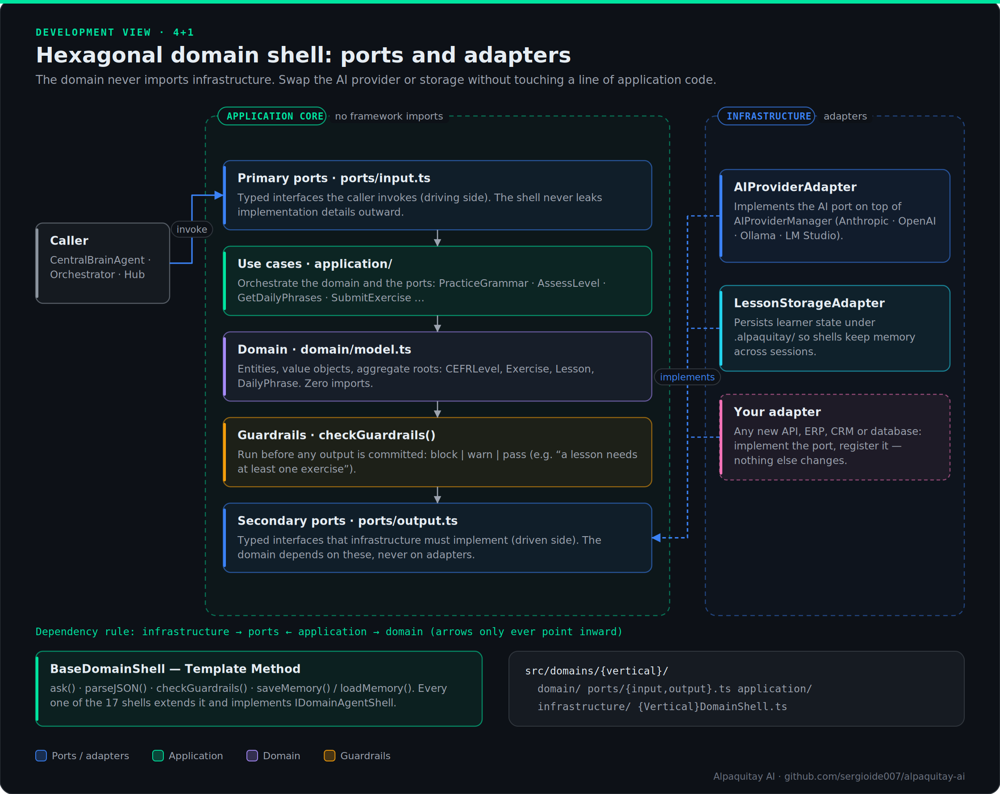</p>

<details>
<summary>Text version of this diagram</summary>

```
           ┌───────────────────────────────────────────────┐
           │               APPLICATION CORE                │
           │                                               │
 Caller ──►│ Primary Port     Use Case      Secondary Port │──► Adapter ──► Real API
           │ (input.ts)    (application/)   (output.ts)    │
           │                                               │
           └───────────────────────────────────────────────┘
```

</details>

**Primary ports** (input.ts): Typed interfaces the caller invokes. The shell never leaks implementation details outward.

**Secondary ports** (output.ts): Typed interfaces infrastructure must implement. The domain never imports from `infrastructure/` — only from `ports/`.

**Adapters** (infrastructure/): Concrete implementations. Swap the AI provider, the storage backend, or a third-party API without touching a single line of domain or application code.

**Guardrails**: Before any output is committed, `checkGuardrails()` runs domain-specific validation rules (e.g., "a lesson must have at least one exercise", "a financial transaction must balance to zero").

---

### 17 Live Domain Agent Shells

All 17 shells are production TypeScript with 0 compilation errors. Each extends `BaseDomainShell` (Template Method pattern), implements `IDomainAgentShell`, and runs through the unified CentralBrainAgent pipeline.

| # | Domain Shell | Status | Use Cases | Key Guardrails |
|---|---|---|---|---|
| 1 | **English Mastery** | ✅ LIVE | practice-grammar, get-daily-phrases, assess-level, submit-exercise, get-progress | CEFR level validation |
| 2 | **Software Engineer** | ✅ LIVE | review-code, analyze-solid, detect-tech-debt, suggest-patterns, estimate-complexity | Complexity thresholds |
| 3 | **Software Architect** | ✅ LIVE | assess-architecture, create-adr, generate-c4, build-tech-radar, evaluate-quality-attributes | ADR decision traceability |
| 4 | **Developer** | ✅ LIVE | implement-feature, debug-issue, refactor-code, explain-code, generate-tests | Test coverage check |
| 5 | **QA** | ✅ LIVE | create-test-plan, generate-test-cases, triage-bug, evaluate-coverage, define-quality-gate | Coverage gates |
| 6 | **DevOps** | ✅ LIVE | design-pipeline, assess-dora, plan-deployment, generate-iac, create-runbook | DORA metrics |
| 7 | **DevSecOps** | ✅ LIVE | design-secure-pipeline, threat-model, assess-samm, scan-findings-triage, generate-sbom | OWASP SAMM level |
| 8 | **Security** | ✅ LIVE | audit-compliance, plan-pentest, manage-risk-register, respond-incident, assess-csf | Critical risk blocking |
| 9 | **Infrastructure** | ✅ LIVE | plan-capacity, design-network, create-sla, plan-dr, configure-monitoring | SLA availability |
| 10 | **Cloud** | ✅ LIVE | design-architecture, well-architected-review, optimize-cost, plan-migration, generate-iac | Well-Architected pillars |
| 11 | **Marketing** | ✅ LIVE | plan-campaign, segment-audience, analyze-seo, create-content, measure-roi | ROAS threshold |
| 12 | **Process** | ✅ LIVE | map-process, gap-analysis, value-stream-map, iso-compliance, optimize-process | ISO compliance gaps |
| 13 | **AI Expert** | ✅ LIVE | evaluate-llm, design-rag, engineer-prompt, design-ai-system, assess-governance, design-mlops | EU AI Act risk tiers |
| 14 | **Business** | ✅ LIVE | design-business-model, strategic-analysis, define-okrs, financial-model, market-analysis, build-business-case | LTV:CAC · runway · ROI |
| 15 | **Quantum Readiness** | ✅ LIVE | crypto inventory, quantum-threat timeline, PQC migration plan, CBOM, crypto-agility assessment | QR-001…003 |
| 16 | **Well-Architected** | ✅ LIVE | pillar reviews and improvement plans across the Well-Architected pillars | WAF-001…003 |
| 17 | **Zero Trust** | ✅ LIVE | zero-trust posture assessment and roadmap | ZT-001…004 |

---

### Multi-Agent Orchestration Stack

<p align="center">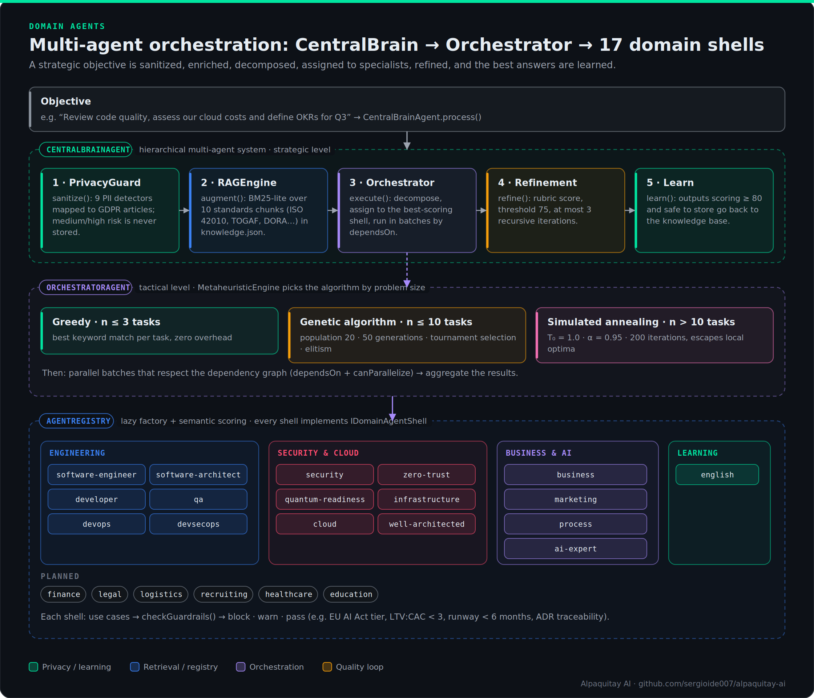</p>

<details>
<summary>Text version of this diagram</summary>

```
┌──────────────────────────────────────────────────────────────────────┐
│                        CentralBrainAgent                             │
│                                                                      │
│  1. PrivacyGuard.sanitize()     ← PII detection (9 detectors)   │
│  2. RAGEngine.augment()         ← BM25-lite knowledge retrieval      │
│  3. OrchestratorAgent.execute() ← Multi-agent task dispatch          │
│  4. RecursiveRefinement.refine()← Quality improvement loop           │
│  5. RAGEngine.learn()           ← Store high-quality outputs back    │
└──────────────┬───────────────────────────────────────────────────────┘
               │
               ▼
┌──────────────────────────────────────────────────────────────────────┐
│                       OrchestratorAgent                              │
│                                                                      │
│  MetaheuristicEngine (auto-selects algorithm by problem size):       │
│  ├── n ≤ 3 tasks  → Greedy (immediate, zero overhead)                │
│  ├── n ≤ 10 tasks → Genetic Algorithm (population=20, gen=50)        │
│  └── n > 10 tasks → Simulated Annealing (T₀=1.0, α=0.95, i=200)      │
│                                                                      │
│  → Decomposes objective into tasks                                   │
│  → Assigns each task to the best-scoring Domain Shell                │
│  → Executes in parallel batches respecting dependency graph          │
└──────────────┬───────────────────────────────────────────────────────┘
               │
    ┌──────────┼──────────┬──────────┬──────────┬──────────┐
    ▼          ▼          ▼          ▼          ▼          ▼
EnglishShell  SEShell  ArchShell  AIShell  BizShell  + 9 more shells
```

</details>

#### RAG Knowledge Base (BM25-lite)
- 10 seed chunks: ISO/IEC 42010 · TOGAF · DORA Metrics · ISO 27001 · ISO 29119 · ISO 9001 · CEFR · AWS WAF · SOLID · Six Sigma
- Persists to `.alpaquitay/orchestration/knowledge.json`
- `RAGEngine.learn()` adds high-scoring outputs back (score ≥ 80)

#### PrivacyGuard (GDPR / ISO 27001 / ISO 27018)
- 9 PII detectors: email, phone, SSN, national ID, credit card, IBAN, IP address, date of birth, medical record number
- Sanitizes before AI calls; blocks storage of medium/high-risk content
- GDPR Article 5 (data minimization) + Article 17 (right to erasure) mapped

---

### Complete File Structure (60+ files, 0 TypeScript errors)

> **Docs tab (v3.5):** `src/documents/` holds `ZipLite`, `DocumentModel`, the Markdown / DOCX / EPUB adapters, `PdfReader`, `Documents` (load · apply · export), `DocumentAgent` and `DocsController`; the UI is `src/panel/DocsTab.ts`.

```
src/domains/
  interfaces/
    DomainAgentShell.ts           ← IDomainAgentShell, DomainId (17 live + 6 planned)
  shared/
    BaseDomainShell.ts            ← Template Method base: ask(), parseJSON(), guardrails
  english/
    domain/model.ts               ← CEFRLevel, Exercise, Lesson, DailyPhrase
    ports/input.ts · output.ts    ← Primary + secondary ports
    application/                  ← 4 use case classes
    infrastructure/               ← AIProviderAdapter, LessonStorageAdapter
    EnglishDomainShell.ts
  software-engineer/
    model.ts · SoftwareEngineerShell.ts
  software-architect/
    model.ts · SoftwareArchitectShell.ts
  developer/
    model.ts · DeveloperShell.ts
  qa/
    model.ts · QAShell.ts
  devops/
    model.ts · DevOpsShell.ts
  devsecops/
    model.ts · DevSecOpsShell.ts
  security/
    model.ts · SecurityShell.ts
  infrastructure/
    model.ts · InfrastructureShell.ts
  cloud/
    model.ts · CloudShell.ts
  marketing/
    model.ts · MarketingShell.ts
  process/
    model.ts · ProcessShell.ts
  ai-expert/
    model.ts · AIExpertShell.ts
  business/
    model.ts · BusinessShell.ts
  orchestration/
    AgentRegistry.ts              ← Catalog of 17 shells, semantic scoring, lazy factory
    OrchestratorAgent.ts          ← Task decomposition, parallel batch execution
    CentralBrainAgent.ts          ← Unified pipeline: RAG + Privacy + Orchestration
    rag/
      KnowledgeBase.ts            ← BM25-lite retrieval, ISO seed chunks, persistence
      RAGEngine.ts                ← augment(), complete(), learn()
    privacy/
      PrivacyGuard.ts             ← 9 PII detectors, GDPR Article mapping, risk scoring
    metaheuristic/
      GeneticOptimizer.ts         ← Population 20, 50 gen, tournament selection, elitism
      RecursiveRefinement.ts      ← Bounded recursive quality improvement, rubric scoring
      MetaheuristicEngine.ts      ← Algorithm auto-selection + refinement orchestration
```

---

### Usage Examples

#### Via CentralBrainAgent (recommended)

```typescript
const brain = new CentralBrainAgent();
await brain.initialize(provider, workspacePath);

// Multi-domain objective — automatically decomposed and distributed
const result = await brain.process(
  'Review the code quality, assess our cloud architecture costs, and define OKRs for Q3'
);
// → Privacy sanitized → RAG augmented → 3 tasks assigned to SE, Cloud, Business shells
// → MetaheuristicEngine optimizes task order → Parallel execution → Refined output
```

#### Direct Domain Shell: AI Expert

```typescript
const result = await brain.delegateTo('ai-expert', 'assess-governance', {
  system:  'Customer credit scoring model',
  context: 'Used in EU for automated loan decisions',
});
// result.data.euAiActRiskTier → 'high'
// Guardrail AI-001: blocks if no humanOversightMechanisms defined
```

#### Direct Domain Shell: Business

```typescript
const result = await brain.delegateTo('business', 'financial-model', {
  business: 'B2B SaaS for HR teams',
  scenario: 'base',
  months:   24,
});
// result.data.unitEconomics.ltvCacRatio → 4.2
// result.data.runway → 18  (months)
// Guardrail BIZ-001: warns if LTV:CAC < 3x
// Guardrail BIZ-002: blocks if runway < 6 months
```

#### English Shell (Reference Implementation)

```typescript
const result = await brain.delegateTo('english', 'assess-level', {
  learnerId:  'alex',
  sampleText: 'Yesterday I have gone to the market and buyed some vegetables.',
});
// result.data.assessment.proposedLevel  → 'A2'
// result.data.assessment.weaknesses     → ['grammar']
// result.data.generatedLessons          → 3 starter lessons
```

#### Agent Catalog

```typescript
// Discover all agents and their capabilities
const catalog = brain.getAgentCatalog();
// → 17 entries with domainId, version, capabilities[], standards[], tags[]

// Semantic search for the right agent
const registry = AgentRegistry.getInstance();
const best = registry.findByUseCase('design a RAG pipeline');
// → 'ai-expert' (highest semantic score)
```

---


---

## Why Alpaquitay?

| Feature | Alpaquitay | GitHub Copilot | ChatGPT |
|---------|-----------|----------------|---------|
| Works offline (Ollama/LM Studio) | ✅ | ❌ | ❌ |
| Privacy-first (no servers) | ✅ | ❌ | ❌ |
| SDLC with executable gates | ✅ | ❌ | ❌ |
| DORA metrics from git | ✅ | ❌ | ❌ |
| Debt tracking | ✅ | ❌ | ❌ |
| Diff-first writes (review before apply) | ✅ | ❌ | ❌ |
| Legacy project support (no `src/` assumption) | ✅ | ⚠️ | ⚠️ |
| Open source (MIT) | ✅ | ❌ | ❌ |

---


---

## Contributing

Contributions are welcome — see [CONTRIBUTING.md](./CONTRIBUTING.md). Quick start:

```bash
git clone https://github.com/sergioide007/alpaquitay-ai.git
cd alpaquitay-ai && npm ci
npm run compile && npm run lint && npm test
```

Press `F5` in VS Code to launch the Extension Development Host. Diagram sources live in [`docs/diagrams/`](./docs/diagrams) (SVG for editing, PNG for the Marketplace README, plus the Python generators in `src/`).


## Author & contact

Built by **Sergio Perez Ruiz**, Senior Software Engineer and author of *Código Sintético* (Spanish) / *Synthetic Code* (English). The harness applies the ideas of the book; the YouTube channel explains them.

| Channel | Use it for |
|---|---|
| Email: [sergio@specsolid.com](mailto:sergio@specsolid.com) · [sergioide007@gmail.com](mailto:sergioide007@gmail.com) | Direct contact, collaborations, privacy requests |
| [LinkedIn](https://www.linkedin.com/in/sergioide007/) | Professional contact and project news |
| [Medium](https://medium.com/@sergioide007) | Articles on SpecSolid and agentic software engineering |
| [YouTube: @codigosinteticolibro](https://www.youtube.com/@codigosinteticolibro) | Videos about the book *Código Sintético* (in Spanish) |
| [GitHub Issues](https://github.com/sergioide007/alpaquitay-ai/issues) | Bugs and feature requests |
| [SECURITY.md](SECURITY.md) | Vulnerabilities: report them privately by email, not in a public issue |

If Alpaquitay is useful to you, a ⭐ [star on GitHub](https://github.com/sergioide007/alpaquitay-ai/stargazers) helps others find it.

---

## License

MIT — see [LICENSE](./LICENSE).
