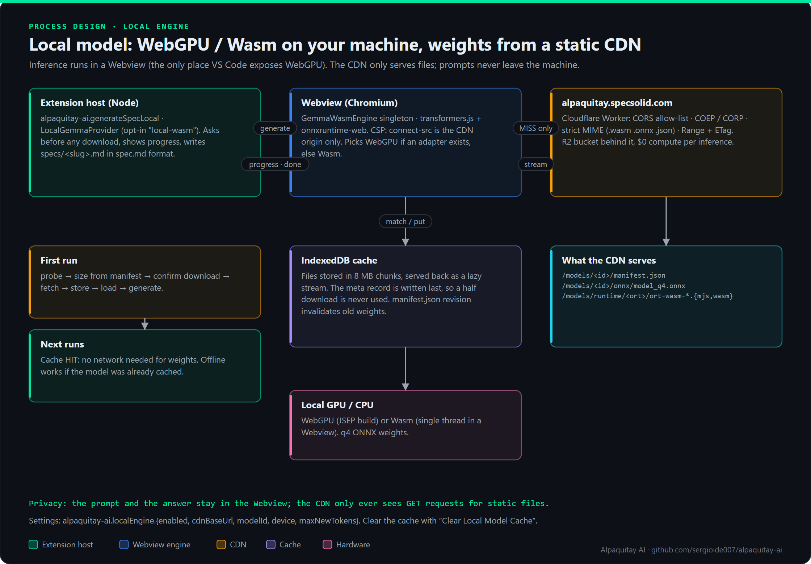

# Local Gemma engine — architecture, threat model and setup

> Status: implemented and unit/e2e-tested at code level (Node + Jest). **Not yet exercised in a real VS Code with a real
> model** — see [What is not verified yet](#8-what-is-not-verified-yet). Facts about third parties were checked on 2026-10-24
> against primary sources, linked inline. Built against transformers.js 4.3.1 and onnxruntime-web 1.31.0-dev.20260914-8d85527a0.

## 1. What it is, and what it is not

**It is:** an opt-in way to draft a `spec.md` with a Gemma model that runs **on the user's own GPU/CPU inside VS Code**. The
weights are static files from a CDN you control; no prompt, no code and no answer ever goes to a model server.

**It is not:** a replacement for a cloud model. A 2B-class model drafts decent first versions of a spec; it will not match a
frontier model, and the command says so when the output does not follow the format. The value is privacy, offline use and zero
inference cost, not quality.

## 2. Architecture



| Zone | Runs in | Trusts | Never does |
|---|---|---|---|
| Extension host | Node (VS Code's Electron) | Ed25519 keys compiled into the extension (+ optional user keys) | decompress anything from the network; open the model Webview before the manifest verified |
| Engine Webview | Chromium sandbox | the manifest the host verified; ONNX Runtime hashes pinned in the bundle | execute a byte it could not hash; load a script from a remote origin (CSP) |
| CDN (Worker + R2) | Cloudflare | nothing: it is untrusted by design | decide what is valid; the signature does |

Data path of a first run: `probe` (host verifies the signed manifest, Webview reports WebGPU/cache) → capability check *before*
any download → modal consent with the verified size and license → Webview fetches the ONNX Runtime files and checks them against
the pinned SHA-256 → fetches model files through a verifying `fetch` (each 8 MiB block hashed against the signed manifest) →
stores them in IndexedDB → generates → host writes `specs/<slug>.md` with `O_EXCL`.

## 3. Threat model

| # | Threat | Mitigation | Residual risk | Tested by |
|---|---|---|---|---|
| T1 | CDN, bucket or Worker compromised: swapped weights | Ed25519-signed manifest with SHA-256 per 8 MiB block; any mismatch aborts the stream before bytes reach the cache or ONNX Runtime; files not in the manifest are refused | Theft of the signing key (rotation: §7) | `integrity.test`, `manifestTrust.test`, `cdnTooling.e2e.test` |
| T2 | CDN serves malicious ONNX Runtime JS/Wasm | SHA-256 of the exact runtime files pinned in the extension bundle at build time; the Webview loads them itself and passes `blob:` URLs to ONNX Runtime; CSP `script-src` has **no remote origin** | A compromised extension publisher account | `runtimeLoader.test`, `LocalEngineHost.test` (CSP) |
| T3 | Rollback to an older, validly signed manifest | Monotonic `sequence`; the highest seen is persisted; lower is refused | A first install has nothing to compare against | `manifestTrust.test`, `cdnTooling.e2e.test` |
| T4 | **A decompressor parses attacker bytes before the signature is checked** | The manifest path uses `node:https` with `Accept-Encoding: identity` and rejects any `Content-Encoding` at the header stage; `fetch()` is not used there | The Webview's network stack (Chromium) still decodes `br` for model/runtime files; T1/T2 only protect after decoding, so keep VS Code updated | `safeHttp.test` |
| T5 | MITM / TLS confusion | https only (loopback http for local mirrors); the CDN must be a DNS name — IP literals in any spelling are rejected, which sidesteps the TLS IP-literal bug class | A CA mis-issuing for the CDN domain: the signature still protects content | `cdnPolicy.test` |
| T6 | A repository's `.vscode/settings.json` redirects downloads or injects keys | `enabled`, `cdnBaseUrl`, `modelId`, `extraTrustedKeys` are `application`-scoped (user settings only) | A user pasting a hostile key into their own settings | `package.json` schema, `verify-marketplace.js` |
| T7 | Model output abuses the file write (path traversal, overwrite) | The slug is generated (`[a-z0-9-]`), the file is created with `O_EXCL`, nothing from the model is executed | Output is untrusted *text*: review specs like any generated content | `GenerateSpecLocal.test` |
| T8 | Resource exhaustion: huge manifest, huge prompt, full disk | Caps on model size (8 GiB), file size, file count, manifest size and prompt length; storage-quota preflight; capability checks before download | A very old or small machine can still be slow | `cdnPolicy.test`, `enginePolicy.hardening.test` |
| T9 | Two overlapping generations corrupt the ONNX session | One inference at a time (serial queue); cancelling targets one request id | — | `enginePolicy.hardening.test` |
| T10 | Build/publish pipeline on a vulnerable Node.js | `scripts/check-node-security.js` fails CI/publish/release on EOL or unpatched Node; `.npmrc` `ignore-scripts=true` | The floor must be updated with each Node security release | `npm run check:node` |

Out of scope: an attacker who already controls the user's machine or the VS Code process.

### The October 2026 Node.js / Brotli lesson

The [Node.js 2026-10-21 security release](https://nodejs.org/en/blog/vulnerability/october-2026-security-releases) fixed an
out-of-bounds write in the Brotli decoder (CVE-2026-111497) reachable when `node:zlib` decodes attacker-supplied data; the fixed
versions are 22.23.4, 24.22.1 and 26.12.1, and end-of-life lines get no patch. The root cause is in the upstream Brotli library
(secondary sources give 1.0.3–1.2.0 as affected and 1.0.10 / 1.1.1 / 1.2.1 as fixed). We confirmed on Node 22 that `fetch()`
advertises `br, gzip, deflate` over HTTPS and decodes a `Content-Encoding: br` body transparently. In a signed-manifest design that
means the decoder would run **before** the signature check, so "the CDN is untrusted" would not have been fully true. T4 closes
that gap for the extension host.

What we could **not** confirm: whether the Electron/Chromium inside each VS Code release already carries the fix. An Electron
pull request ([electron/electron#51087](https://github.com/electron/electron/pull/51087)) notes that Electron uses Chromium's
Brotli, so the Node version string is not the right indicator. Keep VS Code current.

## 4. Failure register

| Failure | Detected by | What the user sees | Status |
|---|---|---|---|
| Manifest unsigned / wrong key / tampered | signature check (host) | error; the Webview never opens | tested |
| Block hash mismatch, short or long body | verifying fetch | download aborts, nothing cached | tested |
| Download dies half way | IndexedDB meta record is written last | partial data is never served; chunks removed | tested |
| `Content-Encoding` makes `Content-Length` lie | cache ignores the header when encoded | a healthy download is not rejected | tested |
| Model needs WebGPU, machine has none | capability check on the verified manifest | error **before** any download | tested |
| No WebGPU and the model is > 512 MiB (manifest allows CPU) | `gpuRequired()`: size ceiling for single-thread Wasm | error before download/generation instead of hours at ~0.15 tok/s | tested |
| VS Code fell back to software rendering (GPU process crashed) | WebGL renderer string in the Webview (`noWebGpuReason`) | the error says why and to restart VS Code completely | tested (policy); diagnosed on a real machine |
| Stream hands over a whole file as one piece (`new Response(uint8Array)` in Chromium) | IndexedDB records capped at 8 MiB regardless of the stream | — (a single 859 MB record hung the Webview) | fixed and tested; verified in VS Code |
| GPU out of memory in prefill on a big-vocabulary model | graph patched to last-token logits (`scripts/onnx-last-token-logits.py`); session dropped after a failed run | plain-language error; the next run reloads the model | fixed; verified in VS Code with a 760-char request |
| Model declares more RAM than the machine has | `os.totalmem()` vs `minRamBytes` | error before download | tested |
| Webview storage quota too small | `navigator.storage.estimate()` preflight; `QuotaExceededError` mapping | clear message; partial data removed | tested (policy); not on a real quota |
| `q4f16` garbage on some GPUs/models ([onnxruntime#26732](https://github.com/microsoft/onnxruntime/issues/26732)) | `dtype=auto` uses q4f16 only with WebGPU + `shader-f16`; `localEngine.dtype` override | safe default | tested (policy) |
| Verifier stream stalls on small network pieces | unit test with 1-byte pieces | — | fixed and tested |
| CDN offline after the first run | last verified manifest re-verified against current keys | works offline; the dialog says "offline copy" | tested |
| Signing key revoked | offline copy re-verified against current keys | refused | tested |
| Reasoning block in Gemma 4 output | `stripThinking` | clean spec | tested |

## 5. Objections you will hear, and honest answers

1. **"Why a Webview?"** The extension host is Node without WebGPU; the Webview is Chromium and can expose it. Cost: a visible tab that must stay open.
2. **"Why not Ollama / LM Studio?"** Those remain first in `auto` and are better for big models. This engine is for people who cannot or will not install a server. It is opt-in.
3. **"You execute remote code in a developer tool."** The runtime is pinned by hash inside the VSIX; the CDN can only deliver bytes that match. The weights are data and are signed.
4. **"Is $0 real?"** Inference cost is $0 by construction. Hosting is $0 only inside free tiers. Per [Cloudflare R2 pricing](https://developers.cloudflare.com/r2/pricing/): Standard free tier is 10 GB-month storage, 1 M Class A and 10 M Class B operations per month, egress free; beyond it, $0.015/GB-month, $4.50/M Class A, $0.36/M Class B. The [Workers free plan](https://workers.cloudflare.com/pricing/.md) lists 100 k requests/day and 10 ms CPU per request. Two dtypes of Gemma 4 E2B (~6.7 GB) fit in 10 GB. Re-check those pages before you promise "free" in public.
5. **"A 1.5B model is weak."** Yes. Hence: drafts, not decisions; a format check with a warning; Ollama stays available. The default was chosen by measurement (§6), not by name.
6. **"1.3 GB in IndexedDB?"** The preflight checks the quota first, and the cache writes records of at most 8 MiB because very large single IndexedDB values are fragile (one 859 MB record hung a real Webview). transformers.js still reads each file fully into memory to build the ONNX session, so peak memory is roughly the model size.
7. **"Licensing?"** The default model, Qwen2.5-Coder 1.5B Instruct, is Apache-2.0 upstream; the CDN serves its `LICENSE.txt` and a `NOTICE.txt` that states the origin, the revisions and our two graph modifications. The manifest carries a `license` field shown in the consent dialog. Gemma 3 uses the Gemma Terms of Use, which carry use restrictions: that is one reason it is no longer the default.
8. **"Old VS Code?"** `engines.vscode` is `^1.85` for the extension; the local engine needs a Chromium with WebGPU and modern JavaScript. Unsupported combinations should fail with a message, not silently. The minimum version is not established (§8).

## 6. Choosing the model (measured 2026-11-15)

Goal: the best model **for software development**, fast enough to use (≥ 3 tok/s), with the safest terms. Every candidate
ran through the real extension in an isolated VS Code 1.146.0, on the reference laptop (ThinkPad P1 Gen 3, Intel UHD gen-9
iGPU with `shader-f16`): served from a local CDN with a throwaway signing key, same 760-character Spanish request, same engine.
Licenses read from the upstream model repositories; sizes from the Hugging Face API.

| Model (ONNX, onnx-community) | License | Download | Result in VS Code | Specification quality |
|---|---|---|---|---|
| **Qwen2.5-Coder 1.5B Instruct** `q4f16` (**default**) | **Apache-2.0** | 1.26 GB | **3.3–4.8 tok/s** | best: concrete engineering tasks, `SPEC-NNN` numbering, epics, request language |
| Gemma 3 1B `q4` (previous test model) | Gemma Terms of Use (use restrictions) | 0.82 GB | 5.9 tok/s | weak: one epic, no `SPEC-NNN`, content errors |
| Qwen3 1.7B `q4f16` | Apache-2.0 | 1.43 GB | does not load (Wasm heap: `bad_alloc` / "memory copy") | — |
| Granite 4.0 1B `q4f16` / `q4` | Apache-2.0 | 1.19 / 1.70 GB | `q4f16` emits garbage; `q4` fails to create the session | — |
| Gemma 4 E2B `q4f16` | Apache-2.0 | 3.2 GB (5.1 B params) | above the runtime's practical size limit; not staged | — |

What decided it: Qwen2.5-Coder is the only code-specialised candidate that runs here, it writes the most useful specifications,
and Apache-2.0 has no use restrictions and includes a patent grant. The practical model-size limit of onnxruntime-web in a
Webview on this machine lies between 1.26 GB (loads) and 1.43 GB (does not). The `q4f16` file needs WebGPU with `shader-f16`;
without it the extension refuses before downloading, with the reason.

Two prompt findings, now in `GenerateSpecLocal.ts`. With rules alone, the model wrote one giant epic (34 tasks, cut off by the
token limit); a short example fixes the grouping. And with an English example, a Spanish request got English tasks, so the
extension now detects the request language and gives the example and the instruction in that language. Numbered epic headings
("## Epic 1:") are normalised to "## Epic:", and a last task cut off by the token limit is dropped.

### Set it up (default model)

```bash
# 0. Tooling (Node must pass the security floor)
npm run check:node && npm ci && npm run compile && npm run build:engine

# 1. One time: signing key (the private key stays OUTSIDE the repo)
npm run cdn:keygen -- --out ~/.alpaquitay/manifest-signing.pem
#    paste the printed public key into src/local/trustedKeys.ts, then:  npm run compile && npm run build:engine

# 2. Download only what is needed, pinned to the revisions that were measured
B=https://huggingface.co/onnx-community/Qwen2.5-Coder-1.5B-Instruct/resolve/774cc908b6c2be23bc4e8d4e401e4f8b8fba7daf
D=./qwen2.5-coder-1.5b-instruct; mkdir -p $D/onnx
for f in config.json generation_config.json tokenizer.json tokenizer_config.json special_tokens_map.json onnx/model_q4f16.onnx; do
  curl -fL --retry 8 -C - -o "$D/$f" "$B/$f"; done
curl -fL -o $D/LICENSE.txt https://huggingface.co/Qwen/Qwen2.5-Coder-1.5B-Instruct/resolve/2e1fd397ee46e1388853d2af2c993145b0f1098a/LICENSE
#    and write $D/NOTICE.txt: origin, revisions and the two modifications below (Apache-2.0 section 4)

# 3. Prepare the graph (both idempotent): weights to external data, logits for the last position only
pip install onnx onnxruntime numpy
python scripts/onnx-external-data.py $D model_q4f16.onnx
python scripts/onnx-last-token-logits.py $D/onnx/model_q4f16.onnx --verify

# 4. Stage (hashes every 8 MiB block, copies the pinned ONNX Runtime) and sign
npm run cdn:stage -- --model $D --id qwen2.5-coder-1.5b-instruct --label "Qwen2.5-Coder 1.5B Instruct (q4f16)" \
  --license apache-2.0 --dtypes q4f16 --requires-webgpu --system-role native --min-ram-gb 8 --top-p 0.8 --top-k 20
npm run cdn:sign -- --key ~/.alpaquitay/manifest-signing.pem --id qwen2.5-coder-1.5b-instruct

# 5. Upload cdn-staging/models/** to the R2 bucket "alpaquitay-models" (keep the models/ prefix; files above 300 MiB
#    need the multipart uploader), deploy the Worker if it changed
npx wrangler deploy --config worker/wrangler.toml

# 6. Verify the LIVE CDN exactly as the extension will consume it (non-zero exit = do not release)
npm run cdn:verify -- --base https://alpaquitay.specsolid.com --id qwen2.5-coder-1.5b-instruct --full
```

`--requires-webgpu` is deliberate (any model above 512 MiB is GPU-only in the extension anyway). `--min-ram-gb 8` is a
maintainer judgement. `--system-role native` because Qwen's chat template supports a system role. `--top-p 0.8 --top-k 20`
follow the model's `generation_config.json`. Why the two graph steps: a single-file 1.26 GB model is parsed as one protobuf
inside the Wasm heap and failed its first run; and full-sequence logits (151 936-entry vocabulary) exhaust an integrated GPU
on long prompts.

**First run in VS Code (F5), in this order:**
1. (Optional) user settings: `"alpaquitay-ai.localEngine.enabled": true`. The command works either way.
2. Run **Alpaquitay AI: Generate Specification (Local Gemma)** (the command keeps its name; the default model is Qwen2.5-Coder). Expect the tab "Alpaquitay · Motor local" to open and a modal showing ≈1.26 GB, apache-2.0 and "manifiesto firmado".
3. Watch the progress notification. The second run must start with no download prompt (cache hit).
4. If it reports that WebGPU is unavailable, read the reason in the message. "Renderizado por software" means VS Code's GPU
   process crashed earlier in the session and Chromium disabled the GPU for the **whole app**: close **every** VS Code window
   and start it again. Check with `code --status` → "GPU Status" (`webgpu: enabled` is required). Note that the Extension
   Development Host (F5) runs inside the VS Code that launched it, so Chromium switches in `launch.json` `args` have no effect,
   and `argv.json` only accepts a short allow-list of switches (none of them enable WebGPU).
5. **Clear Local Model Cache** must free the space, and the next run must ask for confirmation again.

Other models go through the same pipeline. Gemma generations without a native system role need `--system-role fold`; for
Gemma prefer `q4` over `q4f16` (the onnxruntime issue above). Anything above 512 MiB is GPU-only in the extension whatever the
manifest says (`CPU_MAX_MODEL_BYTES`); pass `--requires-webgpu` so the manifest says so too. Run both graph scripts on any
decoder with a large vocabulary (the logits patch looks through a final `Cast` and checks itself with `--verify`), and keep a
model below ≈1.3 GB until the Wasm heap limit is lifted. Measure a new model with a real VS Code run before making it the default.

## 7. Operations

- **Update a model:** re-run `cdn:stage` (new `revision`, higher `sequence` automatically) → `cdn:sign` → upload → `cdn:verify --full`. Clients drop the old weights on their next run.
- **Roll back a bad model:** do **not** re-upload an old manifest (it is refused as a rollback). Re-stage the old files so they get a *new, higher* `sequence`.
- **Rotate the signing key:** add the new public key to `trustedKeys.ts`, release the extension, switch signing to the new key, and remove the old key in a later release. Users who have not updated trust only the old key and will refuse manifests signed by the new one: plan the window.
- **Key compromise:** remove the key from `trustedKeys.ts` and release immediately; stored offline manifests signed by it are rejected on the next run.
- **Mirrors:** `localEngine.cdnBaseUrl` + `localEngine.extraTrustedKeys` (user settings only) let an organisation host its own copy under its own key.
- **Cloudflare:** disable any transformation (minify, compression rules, Polish) on `/models/*`; the Worker already sends `Cache-Control: no-transform`.
- **Node.js security floor:** update `scripts/node-security-floor.json` after each [Node.js security release](https://nodejs.org/en/blog/vulnerability/). It is checked in the CI, publish and release workflows and in `verify-marketplace.js`.

## 8. What is not verified yet

These are the facts the code cannot establish without a real VS Code and a real GPU. Each has a runtime guard, but each needs one real check:

1. **WebGPU in a VS Code Webview** (`navigator.gpu`, secure-context rules). Guarded: probe → clear error or Wasm fallback.
   *First real run (2026-11-14, Windows 11, VS Code stable, Gemma 3 1B q4):* consent, signed download (839 MB), block verification and model load all worked; the Webview reported **no WebGPU adapter**, so the engine fell back to Wasm with one thread and the old 15-minute total timeout expired during generation. Fixed with the inactivity timeout and token-by-token progress (CHANGELOG 3.6.1). Same model and runtime measured in Chrome on the same laptop (ThinkPad P1 Gen 3, Intel UHD gen-9 + NVIDIA): **Wasm, 1 thread: 0.15 tok/s** (prefill 10.6 s, so CPU is not a usable path for this model); **WebGPU (Intel iGPU): 5.4 tok/s** (prefill 3.0 s). That run also showed that onnxruntime-web 1.31 needs the *asyncify* runtime for WebGPU (`webgpuInit`), not the *jsep* one the build pinned; fixed, and `build:engine` now refuses a mismatched variant. *Resolved 2026-11-15:* VS Code **does** expose WebGPU to Webviews. An isolated VS Code 1.145.2 on the same laptop, with no
   flags, gives the Webview the Intel gen-9 adapter with `shader-f16`. The instance used for the first run had been open for days
   and its GPU process had crashed four times (`D3D11 ... Error allocating Texture2D`, `GL_OUT_OF_MEMORY`). After that, Chromium
   switched the whole app to software rendering (`code --status`: `webgpu: disabled_off`), and the Extension Development Host
   inherits that state. Fix: restart VS Code completely. A real run in VS Code then found two more defects, both fixed (see the
   failure register): the IndexedDB single-record write and prefill OOM from full-sequence logits. **Measured in VS Code:
   3.8–4.2 tok/s** on WebGPU with a 760-character request (gemma-3-1b-it q4, patched graph); first run about two minutes.
   *Re-checked after restarting VS Code (now 1.146.0, `code --status`: `webgpu: enabled`), against the production CDN
   (unpatched graph), with 9.7 GB of free RAM:* 5.4 tok/s (44 chars), 6.0 tok/s (760 chars), 3.6 tok/s (6,080 chars). The
   prefill OOM therefore depends on free memory: it appeared with 6.6 GB free and a degraded VS Code. The unpatched graph still
   allocates n × 1 MiB of logits in prefill (≈ 1.7 GB for 6,080 characters, 9 s vs 6 s of prefill at 760 characters), so
   publishing the patched graph remains the fix for machines under memory pressure.
2. **IndexedDB persistence of the Webview origin across restarts.** If it does not persist, the consent dialog reappears with the size (honest, but costly at 3 GB).
3. **Minimum VS Code/Chromium version** that runs the bundled transformers.js and ONNX Runtime. Not established; do not publish a number until it is tested.
4. **Memory:** a ~3 GB model in a Webview process. The quota preflight does not measure RAM.
5. **Real Gemma 4 output quality and format adherence** for spec generation.
6. **Electron/VS Code patch status for CVE-2026-111497** (§3).
7. **Cloudflare behaviour** with multi-GB `Range` and streamed responses on the free plan: run `cdn:verify --full` and one real download before announcing.
